# Awesome-Geospatial-Analysis-GIS-Open-Data 🗺️

  

  
  
  
  
  
  
  

---

# 🌍 Top Geospatial Analysis, GIS Platforms & Open Data Ecosystem 🛰️

> **The definitive curated index of enterprise GIS SaaS platforms, cloud Earth-observation suites, spatial data science toolkits, vector-tile web renderers, and open geospatial repositories.**

Welcome to the comprehensive guide for modern **Geospatial Analysis**, **Geographic Information Systems (GIS)**, and **Open Spatial Data**. This repository indexes production-ready commercial SaaS vendors, cloud-native geoprocessing environments, and open-source libraries enabling developers, cartographers, earth-observation scientists, and data engineers to build scalable spatial pipelines.

### 🔍 Key Geospatial Domains Covered
* 🌐 **Vector Web Mapping & 3D Globes**: GPU-accelerated client rendering using MapLibre GL JS, Leaflet, CesiumJS, deck.gl, and OpenLayers.
* 🖥️ **Desktop & Enterprise GIS Servers**: Workhorse spatial analytics applications including QGIS, PostGIS, GeoServer, and Martin vector-tile servers.
* 🐍 **Python Spatial Data Science**: Scientific geoprocessing stacks powered by GeoPandas, GDAL, Shapely, Rasterio, Leafmap, and Xarray.
* 🛰️ **Earth Observation & Remote Sensing**: Planetary-scale analytics spanning Google Earth Engine, Sentinel Hub, Copernicus, Landsat, and STAC catalogs.
* 📦 **Cloud-Native Geospatial Data Formats**: High-performance GeoParquet, Cloud Optimized GeoTIFF (COG), PMTiles, FlatGeobuf, and Overture Maps data models.

---

## 📑 Table of Contents
- [📊 Sector Overview & Market Dynamics](#-sector-overview--market-dynamics)
- [☁️ SaaS & Hosted Commercial Platforms](#️-saas--hosted-commercial-platforms)
- [💻 Open-Source GitHub Projects](#-open-source-github-projects)
- [📈 Star History](#-star-history)
- [🛠️ How to Contribute](#️-how-to-contribute)
- [⚠️ Disclaimer](#️-disclaimer)
- [💖 Support & Sponsorship](#-support--sponsorship)

---

## 📊 Sector Overview & Market Dynamics 📈

The global Geographic Information Systems (GIS), Spatial Analytics & Earth Observation SaaS market is estimated at **$16.5B–$20.8B+ in 2026** and projected to expand at a **12%–16% CAGR**. Growth is strongly accelerated by cloud-native geospatial data lakes (GeoParquet, Cloud Optimized GeoTIFFs, STAC), high-cadence commercial satellite constellations, and AI-driven geospatial foundation models for automated land-use and feature extraction.

The market landscape demonstrates a **moderately fragmented, dual-structured dynamic**:
1. **Proprietary Commercial Core**: The enterprise GIS, spatial imagery storage, and planetary compute tiers exhibit high concentration around market leaders such as Esri (ArcGIS Online), Google Earth Engine, Mapbox, and Planet Labs.
2. **Open-Source Innovation Layer**: Vector tile serving, spatial database indexing, in-browser WebGL map rendering, and Python data science pipelines remain widely distributed and dominated by open standards (`QGIS`, `PostGIS`, `GDAL`, `GeoPandas`, `PMTiles`, `Overture Maps`).

---

## ☁️ SaaS & Hosted Commercial Platforms 🏢

*Sorted descending by company scale (valuation / annual revenue).*

| Platform | Description | Company Scale (Valuation / Revenue) | Starting Paid Tier | Free Tier / Trial Limit |
| :--- | :--- | :--- | :--- | :--- |
| **[Google Earth Engine](https://earthengine.google.com)** | Planetary-scale cloud geospatial analysis platform combining petabytes of satellite imagery (Landsat, Sentinel, MODIS) with parallel Python/JS compute. | **Part of Alphabet Inc.** (~$350B+ Alphabet revenue; ~$2T+ market cap) | **$500 / month** (Basic commercial tier platform fee; compute usage at ~$0.40/EECU-hour) | **Forever Free Non-Commercial & Research Plan** (Free petabyte-scale access and compute for academic, research, and non-profit usage) |
| **[ArcGIS Online (Esri)](https://www.esri.com/en-us/arcgis/products/arcgis-online/overview)** | Industry-standard cloud GIS, spatial analytics, StoryMaps, and enterprise location-intelligence SaaS platform powering governments and enterprises globally. | **~$2.0B+ Annual Revenue** (Privately held GIS market leader) | **$700 / user / year** ($700/yr for Creator license; $100/yr for Viewer license) | **Forever Free Developer Account** (Includes **2,000,000 free basemap & tile requests/month**, 20,000 geocodes/month, and 100 MB data hosting) |
| **[Mapbox](https://www.mapbox.com)** | Developer-first cloud location platform offering vector maps, Mapbox GL, turn-by-turn navigation, geocoding, and Isochrone APIs. | **~$1.0B–$1.2B Valuation** (~$150M+ est. ARR; backed by SoftBank/Foundry) | **$5.00 per 1,000 web map loads** (Pay-as-you-go pay scale once exceeding the free monthly tier) | **Forever Free Developer Tier** (**50,000 free web map loads/month**, 25,000 mobile MAUs, and 100,000 free geocoding requests/month) |
| **[Nearmap (Thoma Bravo)](https://www.nearmap.com)** | High-resolution aerial orthomosaic, oblique imagery, 3D reality mesh, and AI property/infrastructure attribute SaaS covering North America, Australia, and NZ. | **~$730M Take-Private Valuation** (~$150M+ ARR; backed by Thoma Bravo) | **$3,500 / year** (Entry annual subscription for municipal/business spatial packages) | **14-Day Guided Evaluation Trial** (Custom 14-day proof-of-concept trial evaluation arranged via sales demo; no open self-serve tier) |
| **[Planet Insights / Sentinel Hub (Planet Labs)](https://www.planet.com)** | Cloud Earth-observation platform and Sentinel Hub API providing daily high-resolution satellite imagery, planetary variables, and on-the-fly spectral processing. | **~$220M+ Annual Revenue** (~$1B+ public market cap on NYSE: PL) | **€25 / month** (€300 billed annually for Sentinel Hub Exploration Plan, 30,000 Processing Units/month) | **30-Day Full-Access Free Trial** (Includes 30,000 Processing Units, EO Browser, and Copernicus Sentinel/Landsat API endpoints for 30 days) |
| **[CARTO](https://carto.com)** | Cloud-native spatial analytics platform running directly on top of Snowflake, BigQuery, Databricks, and PostgreSQL for large-scale location intelligence. | **~$100M–$200M Est. Valuation** ($61M+ Series C led by Insight Partners) | **$199 / month** billed annually ($299/mo monthly for Starter cloud workspace) | **14-Day Full-Access Free Trial** (Full access to cloud data warehouse connectors, spatial SQL analytics, and CARTO Builder maps for 14 days) |
| **[Felt](https://felt.com)** | Modern, collaborative browser-native GIS and internet mapping platform featuring real-time multiplayer editing, spatial SQL, and instant data styling. | **~$50M–$100M Est. Valuation** ($34M+ VC funding led by Footwork/Bain Capital) | **$200 / month** billed annually ($240/mo monthly for Team plan, 5 editors) | **Forever Free Starter Plan** (**Unlimited maps**, up to **3 editors**, 100 MB file upload limit, and public web sharing) |
| **[QGIS Cloud (Sourcepole)](https://qgiscloud.com)** | Hosted cloud Web-GIS publishing service letting users publish desktop QGIS projects directly to OGC WMS/WFS web maps and PostGIS databases. | **Independent Swiss Open-Core GIS Vendor** (Sourcepole AG; core QGIS project contributors) | **€65 / month** (QGIS Cloud Pro with unlimited databases, password protection, and custom domains) | **Forever Free Community Plan** (**Unlimited public web maps**, 1 PostGIS database, and **50 MB storage** free forever with QGIS Cloud branding) |

---

## 💻 Open-Source GitHub Projects 🔓

*Sorted descending by repository star count. Star count badges link directly to each repository's stargazers page.*

| Project | Stars | Category / Focus | Description |
| :--- | :--- | :--- | :--- |
| **[Leaflet](https://github.com/Leaflet/Leaflet)** |  | 🗺️ Web Mapping | Leading open-source JavaScript library for mobile-friendly interactive maps. |
| **[CesiumJS](https://github.com/CesiumGS/cesium)** |  | 🌐 3D Geospatial & Globe | Open-source JavaScript library for creating world-class 3D globes and geospatial digital twins. |
| **[QGIS](https://github.com/qgis/QGIS)** |  | 🖥️ Desktop GIS Application | Free, Open Source Geographic Information System desktop suite for spatial data creation, editing, and analysis. |
| **[deck.gl](https://github.com/visgl/deck.gl)** |  | 📊 WebGL Data Visualization | WebGL2-powered framework for exploratory large-scale geospatial data analytics and visual rendering. |
| **[OpenLayers](https://github.com/openlayers/openlayers)** |  | 🗺️ Web Mapping | High-performance, feature-packed library for displaying dynamic map data in web browsers. |
| **[MapLibre GL JS](https://github.com/maplibre/maplibre-gl-js)** |  | 🚀 Vector Tile Web Mapping | Open-source, community-led TypeScript library for vector-tile rendering maps with WebGL. |
| **[kepler.gl](https://github.com/keplergl/kepler.gl)** |  | 🌌 Large-scale Geo-Visualization | Kepler.gl is a data-agnostic, high-performance web-based application for visual exploration of large-scale geolocation data. |
| **[GeoLibre](https://github.com/opengeos/GeoLibre)** |  | 🌍 Open Geospatial Ecosystem | Open-source geospatial mapping and GIS library by OpenGeos empowering vendor-free spatial analysis and web visualization. |
| **[H3](https://github.com/uber/h3)** |  | ⬡ Hexagonal Spatial Indexing | Hexagonal hierarchical spatial index developed by Uber for grid-based spatial partition and optimization. |
| **[GDAL](https://github.com/OSGeo/gdal)** |  | ⚙️ Geospatial Data Abstraction | Translator library for raster and vector geospatial data formats released under an MIT style Open Source License. |
| **[GeoPandas](https://github.com/geopandas/geopandas)** |  | 🐍 Python Spatial Data Science | Extends pandas data structures to enable spatial operations and geometric algorithms on geometric types. |
| **[Shapely](https://github.com/shapely/shapely)** |  | 📐 Geometric Analysis | Manipulation and analysis of planar geometric objects, based on GEOS. |
| **[GeoServer](https://github.com/geoserver/geoserver)** |  | 📡 Spatial Map Server | Open source software server written in Java that allows users to share, process, and edit geospatial data via OGC standards. |
| **[Martin](https://github.com/maplibre/martin)** |  | ⚡ Vector Tile Server | Blazing-fast tile server generating vector tiles on the fly from PostGIS, PMTiles, and MBTiles. |
| **[Leafmap](https://github.com/opengeos/leafmap)** |  | 🍃 Python Geospatial Analysis | A Python package for interactive mapping and geospatial analysis with minimal coding in Jupyter environments. |
| **[PMTiles](https://github.com/protomaps/PMTiles)** |  | 🗃️ Cloud-Native Vector Tiles | Cloud-optimized single-file tile archive format for pyramids of map tiles enabled by HTTP Range requests. |
| **[Rasterio](https://github.com/rasterio/rasterio)** |  | 🖼️ Python Raster Analysis | Rasterio reads and writes geospatial raster datasets like GeoTIFFs using Python idiom and GDAL C APIs. |
| **[Apache Sedona](https://github.com/apache/sedona)** |  | ⚡ Distributed Spatial Compute | Cluster computing system for processing large-scale spatial data with Apache Spark and Apache Flink. |
| **[PostGIS](https://github.com/postgis/postgis)** |  | 🐘 Spatial Database Engine | Spatial database extender for PostgreSQL object-relational database, adding support for geographic objects. |

---

## 📈 Star History 🌟

---

## 🛠️ How to Contribute 🤝
Contributions are very welcome! To suggest additions or updates:
1. 🍴 **Fork** this repository.
2. 🌿 Create a branch for your addition (`git checkout -b feature/add-new-gis-tool`).
3. 📝 Add your tool, platform, or open-source library to the appropriate section maintaining existing table formats and sort orders.
4. 🚀 Open a **Pull Request** with a concise description of why the tool is valuable for spatial practitioners.

---

## ⚠️ Disclaimer 📋
All product names, logos, and brands mentioned are property of their respective owners. Company scale metrics and pricing are estimated from public corporate disclosures and are subject to change.

---

## 💖 Support & Sponsorship ☕

Thank you for visiting and using this curated geospatial guide! If you find this resource helpful for your work, research, or projects, please consider supporting the maintenance of this repository:

* ⭐ **Star** this repository to help others discover it.
* 🍴 **Fork** and share it with your spatial, GIS, and data science colleagues.
* ☕ **Buy me a coffee / Sponsor**: Support ongoing maintenance and curation on the [GitHub Sponsor Dashboard](https://github.com/sponsors/ishandutta2007).
